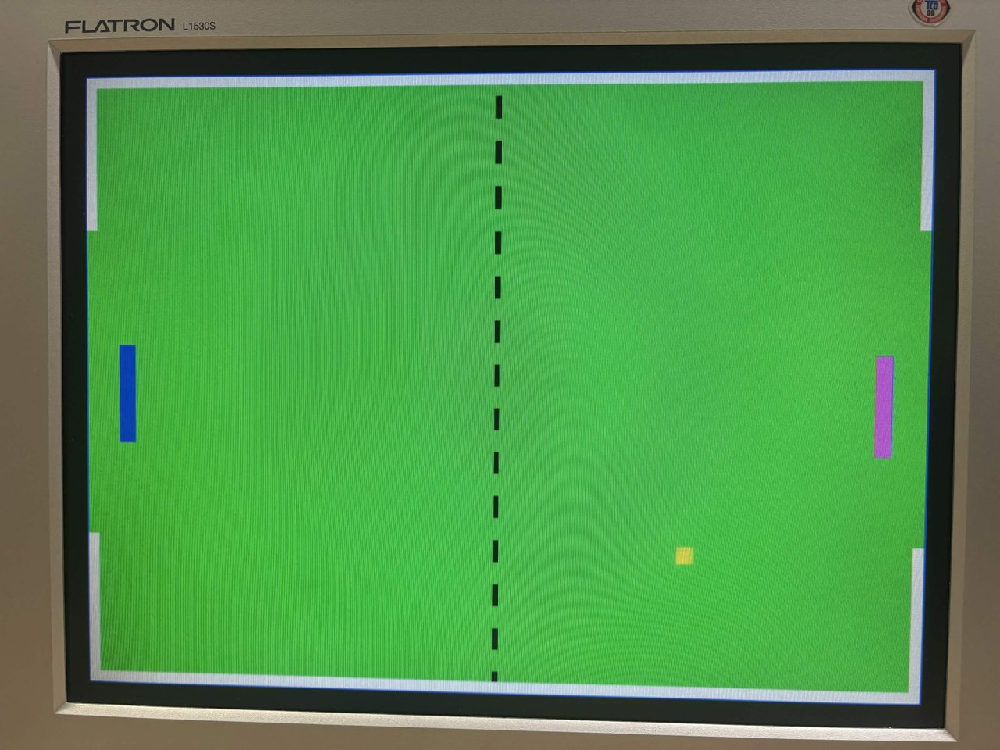
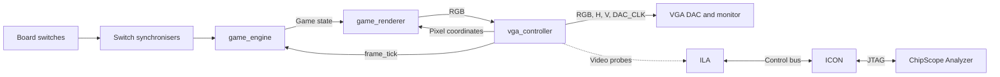
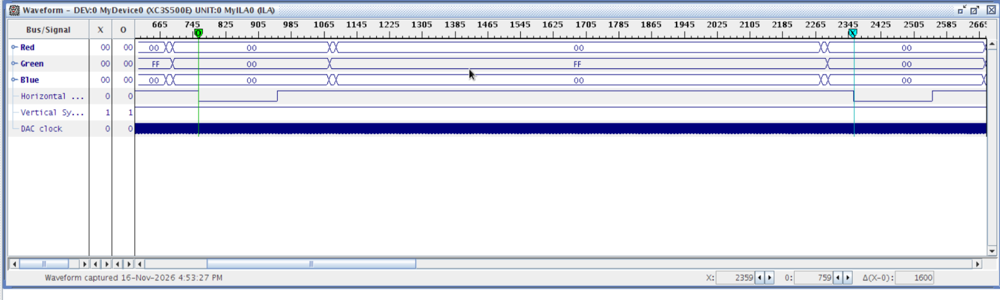

# FPGA VGA Pong

**VHDL | FPGA design | VGA timing | Finite-state machines | Hardware debugging**

A two-player Pong game implemented in VHDL on a Xilinx Spartan-3E FPGA. Custom logic generates the 640 x 480 VGA display, reads board switches, updates the game, and drives the video DAC in real time. The design renders pixels directly from object coordinates without a framebuffer or processor.

Built for COE758: Digital Systems Engineering at Toronto Metropolitan University.

## What it does

- Draws a green playing field, white borders, side gates, a dashed centre line, two coloured paddles, and a yellow ball.
- Moves each paddle up or down using two board switches.
- Reflects the ball from paddles and solid borders.
- Turns the ball red when it passes through a gate, then returns it to the centre for the next serve.
- Generates horizontal sync, vertical sync, and a 25 MHz clock for the video DAC.
- Observes the video outputs using ChipScope ICON and ILA cores.

## Engineering highlights

| Area | Implementation |
| --- | --- |
| Synchronous RTL | A 50 MHz system clock drives sequential logic. A phase bit enables one pixel every two cycles. |
| Video output | Raster counters generate an 800 x 525 scan with a 640 x 480 visible region and active-low sync pulses. |
| Game control | SERVING, PLAYING, and EXITING states handle movement, collisions, gate exits, and restarts. |
| Input handling | Two synchronising stages sample the four board switches before the game uses them. |
| Rendering | Coordinate comparisons and colour priority draw each pixel directly, without stored image memory. |
| Frame consistency | Object positions update during vertical blanking and remain fixed during the visible frame. |
| Hardware verification | ChipScope captures measure the line period, sync pulse widths, and DAC clock cadence. |

## Architecture

`game_top` connects the gameplay, renderer, timing controller, startup reset, and switch synchronisers. `game_debug_top` wraps that design with the ChipScope cores and forwards the same video signals to the board.

The ball advances three pixels per axis per frame, and each paddle moves four pixels per frame. The renderer gives the ball priority over paddles, borders, the centre line, and the field.

## Hardware results

The game was programmed and tested on the lab FPGA with a VGA monitor. Gameplay checks covered paddle movement, border and paddle reflections, gate exits, and ball restarts.

The ILA sampled at 50 MHz, giving 20 ns between samples.

| Signal measurement | Capture difference | Result |
| --- | --- | --- |
| Horizontal line period | 1600 samples | 32 us |
| Horizontal sync low pulse | 192 samples | 3.84 us |
| DAC clock cadence | 2 samples | 40 ns / 25 MHz |
| Vertical sync low pulse | 3200 samples | 64 us |

The expected frame period is 525 x 32 us = 16.8 ms, or approximately 59.52 Hz. This frame rate is calculated from the raster timing. The 8192-sample capture buffer spans 163.84 us and does not measure a complete frame. At two samples per DAC cycle, the DAC trace confirms its sampled cadence rather than fine edge timing.

## Source map

| File | Responsibility |
| --- | --- |
| [`game_pkg.vhd`](src/game_pkg.vhd) | Dimensions, game-state record, movement limits, collisions, and restart rules |
| [`game_engine.vhd`](src/game_engine.vhd) | Clocked game-state updates |
| [`game_renderer.vhd`](src/game_renderer.vhd) | Pixel colour generation |
| [`vga_controller.vhd`](src/vga_controller.vhd) | Raster scan, blanking, sync signals, and DAC clock |
| [`game_top.vhd`](src/game_top.vhd) | Game integration, startup reset, and switch synchronisers |
| [`game_debug_top.vhd`](src/game_debug_top.vhd) | ICON and ILA integration |
| [`project2.ucf`](src/project2.ucf) | FPGA pin assignments and 20 ns clock constraint |

The editable block, process, state, and timing diagrams are in [`docs/architecture.drawio`](docs/architecture.drawio). The seven source files are preserved from the working board project, including their brief comments.

## Build and run

**Target:** Spartan-3E XC3S500E, FG320 package, speed grade -5. The working lab setup used Xilinx ISE 13.4 and ChipScope Pro.

1. Clone the repository and create a VHDL project in ISE for the target above.
2. Add the six VHDL files and `src/project2.ucf`. Compile the package before the modules that use it.
3. For the game alone, set `game_top` as the top module. The gameplay logic does not require ChipScope cores.
4. For the instrumented build, generate the `icon` and `ila` cores using the settings in [`ipcore_dir`](ipcore_dir), add their generated implementation files, and set `game_debug_top` as the top module. Details are in the [debug setup guide](docs/DEBUG_SETUP.md).
5. Run synthesis, implementation, and programming-file generation. Program the resulting bitstream through iMPACT, connect the VGA monitor, and use the switches below.

| Switch | Control |
| --- | --- |
| SW0 | Left paddle up |
| SW1 | Left paddle down |
| SW2 | Right paddle up |
| SW3 | Right paddle down |

Holding both switches for the same paddle, or neither switch, keeps that paddle still.

The supplied constraints match the course lab board's video DAC wiring. A different board requires its own pin mapping and compatible VGA hardware. Generated Xilinx netlists and build outputs are not included in this source repository. Regenerate the ChipScope cores with the matching legacy tools when building the debug wrapper.
